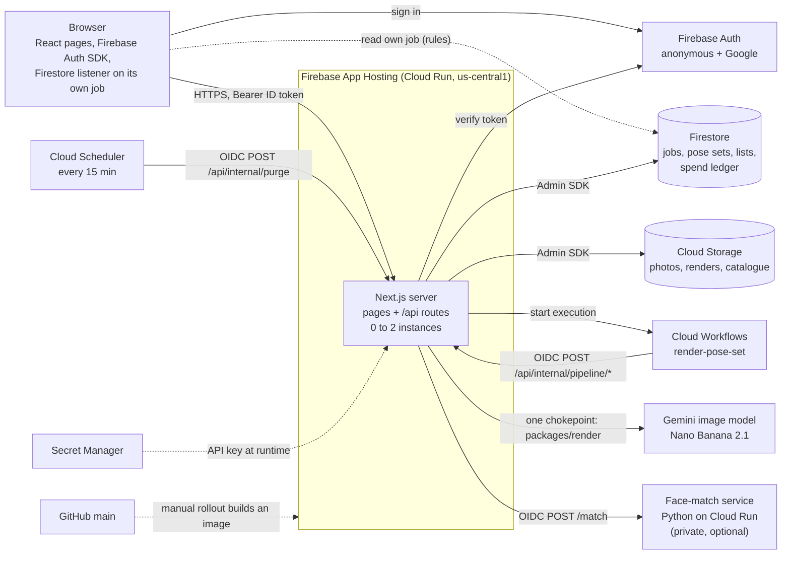
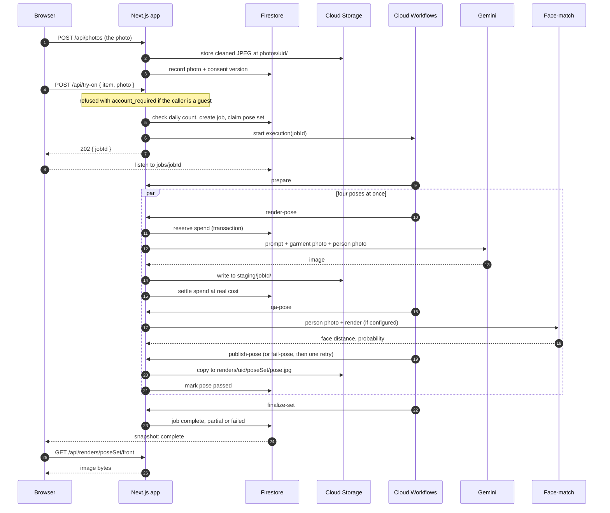

# How Trailroom works

One photo in, four poses out. This document follows a request from the browser to the image model
and back, and says where every piece of state lives. It is written to be read aloud to someone who
has not seen the code. It describes `main` as of 12 October 2026, including the account requirement for starting a render, which is committed but not yet rolled out. The diagrams are Mermaid and
render on GitHub.

Contents: [the whole system](#the-whole-system) · [is it serverless?](#is-it-serverless) ·
[layers](#layers) · [auth](#auth) · [a try-on, step by step](#a-try-on-step-by-step) ·
[the quality gate](#the-quality-gate) · [data design](#data-design) · [caching](#caching) ·
[cost and limits](#cost-and-limits) · [what is weak](#what-is-weak)

## The whole system

There is one main deployable: a Next.js app. It serves the pages, answers the API, and also holds
the code for each step of a render. Everything else is a managed Google service that the app
calls, or that calls the app. One small Python service sits beside it for the face check.

The arrow that surprises people is the loop between the app and Cloud Workflows. The app does not
render inside the request that asked for a try-on. It starts a workflow and returns. The workflow
then calls back into the same app, one HTTP request per step, so no single request has to live as
long as a whole try-on.

## Is it serverless?

Yes, in the sense that matters. Firebase App Hosting builds the repo into a container and runs it
on Cloud Run. Nobody manages a machine, it scales with traffic, and it scales to zero when idle. It
is not "functions": it is one long-running Node process per instance, serving many requests at
once.

| Setting | Value | What it means |
|---|---|---|
| Instances | 0 to 2 | With no traffic nothing runs, so the first visitor after a quiet spell waits for a cold start. |
| Per instance | 1 CPU, 1 GiB, 20 concurrent requests | Low concurrency because renders hold image buffers in memory. |
| Request timeout | 300 seconds | The ceiling for one render step. |
| Deploys | Manual rollout from `main` | Cloud Build makes the image. Config is `apps/web/apphosting.yaml`. |

The consequence to remember: **nothing in the process's memory is durable or shared.** Two
instances do not see each other's memory, and an instance can disappear at any time. So all real
state is in Firestore and Cloud Storage. The only things kept in memory are small caches and rate
limiters, which is why those are the weakest part of the system.

## Layers

The classic picture is rendering engine, servlet, business logic, persistence. The same shape
exists here. The rule that keeps it honest is that only two packages may touch the outside world:
`packages/db` for data and `packages/render` for the image model.

| # | Layer | Where | What it does |
|---|---|---|---|
| 1 | View | `apps/web/src/components`, `src/app/**/page.tsx` | React. Pages are server-rendered for first paint, then run in the browser. State that many screens share lives in providers: who you are, your lists, your running jobs, compare, the account sheet, toasts. All wording is in one file, `src/lib/copy.ts`. |
| 2 | Edge of the server | `src/middleware.ts`, `src/app/api/**/route.ts` | The "servlet" layer. Middleware decides what is reachable (the password switch, security headers). Each route handler is a few lines: read the request, authenticate, call one function, turn the result into a response. About 45 routes. |
| 3 | Business logic | `apps/web/src/server/*.ts` | The rules of the product: may this person start a try-on, is consent current, is this list theirs, what does a friend see on a vote page, what gets deleted. Functions return a typed result (ok or a named error), never a raw HTTP response. |
| 4 | Render pipeline | `packages/pipeline` | The steps of a try-on as separate functions: prepare, render a pose, check it, publish it or fail it, finalize the set. Also the quality gate and the retry policy. The same functions run under Cloud Workflows in production and in-process in tests. |
| 5a | Model chokepoint | `packages/render` | The only code allowed to call the image model. It builds the prompt, knows the price table, and reserves money before every call. Because every call passes through here, the daily cap cannot be bypassed. |
| 5b | Persistence | `packages/db` | The only code allowed to touch Firestore and Cloud Storage. Typed repositories per kind of record, the spend ledger, and the functions that move or delete a whole person's data. |
| 6 | Managed services | Firestore, Cloud Storage, Auth, Gemini | Not our code. |

The catalogue (`packages/catalog`) sits beside the stack: twelve pieces defined in code, plus any
published later, which live in Firestore.

## Auth

There are three kinds of caller, and each proves who it is differently.

| Caller | How it is identified | What it can do |
|---|---|---|
| Guest | Firebase anonymous sign-in, created silently the first time an identity is needed. A real user id, just with no account behind it. | Browse, upload a photo, keep a Favourites list. **Cannot start a try-on**: the server refuses it with `account_required`, so a guest never spends a render. A try-on a guest made before 12 October still shows at thumbnail size only and opens after sign-in. Deleted after 48 hours if they never sign up. |
| Account | Google sign-in in a popup. Google is the only provider. | Everything a guest can do, plus starting try-ons and outfits (5 starts a day), full-size results, lists, asks and compare. Data is kept until they delete it. |
| Google's own services | An OIDC token signed by Google for a specific service account, with this app's address as the audience. | Only the `/api/internal/*` routes: the pipeline steps (Workflows) and housekeeping (Scheduler). |

On every request:

1. The browser asks the Firebase SDK for its current ID token (a short-lived signed JWT) and sends
   it as `Authorization: Bearer …`.
2. The server verifies the signature and also checks that the user still exists, so a deleted
   account's token stops working at once.
3. The result is just `{ uid, isGuest }`. Every query after that is filtered by that uid, and
   another person's record answers 404, never 403.

**Guest becomes account.** If the Google account is new, the guest is *linked* to it: same user
id, so nothing moves and the records simply stop expiring. If the Google account already exists,
linking is impossible, so the browser signs into it and sends the server both tokens. Holding both
is the proof they belong to one person, and the server copies the guest's photos, finished
try-ons, follows and Favourites across.

**A guest cannot start a render.** When a guest presses "Try it on" (after the photo step, if they
have no photo), the account sheet rises with the reason `tryon`. After Google sign-in, by either
path above, the try-on they asked for starts by itself, with the photo they uploaded (the
account's default photo if that one did not carry over), and they land on the queue. Closing the
sheet renders nothing and keeps the photo. The owner's reason (12 October): if the site is going
to spend 20 cents, the person must have signed up.

**After sign-up** a new person lands on a screen offering four pieces to try on with the photo
they just uploaded. There is no step that makes them follow labels first.

**The password.** A separate, older layer: a shared password checked in middleware, switched by
`GATE` in `apphosting.yaml`. It is `off`, so the site is public. Any other value puts it back.

## A try-on, step by step

- **The upload is cleaned on the way in.** The server rotates it upright, shrinks it, re-encodes
  it as JPEG and drops all metadata, including location.
- **The pose set id is deterministic:** user, photo and piece. Asking for the same combination
  twice finds the existing set and cannot render it twice.
- **Money is reserved before the model is called,** in a Firestore transaction on the day's spend
  document. If the reservation would pass the cap, the pose fails with "capacity" and no call is
  made.
- **A render is never served from where it was written.** It lands in `staging/`, and only a pose
  that passed the quality gate is copied to `renders/`. Nothing reads `staging/` for a user.
- **The browser never polls in the normal case.** It listens to its own job document in Firestore
  and the tiles fill in as each pose passes. A slow poll of the API is the fallback.
- **Images are fetched through the API,** with the token. Cloud Storage is closed to browsers
  entirely.
- **The result of a finished try-on is the mirror** (decided 17 October 2026, being built; ADR 0008):
  the first time it is opened the picture comes into focus and she turns all the way round once on her
  own, then the person drags to turn her through Stand, Turn, Walk and Sit. Under the picture are the
  three choices, Not for me, Ask a friend and Love it, and the details. Buy is hidden for now. Until the
  mirror is on `main` the build still shows the earlier reveal, in which the label's photograph wipes
  into the person's own render.

## The quality gate

Every render is checked in `staging/` before anyone can see it (`packages/pipeline/src/qa.ts`).

| Check | What it catches | State |
|---|---|---|
| Decodes, right size, right shape | A broken or tiny image | Always on |
| Not blank | A flat grey or white field | Always on |
| Not a copy of the input | The model handing the photo back unchanged | Always on |
| Same face as the person | A render that put someone else's face on them | On in production since 12 October (the service is deployed and `FACE_MATCH_URL` is set); skipped if the variable is unset. Whether the identity result was recorded as passed on a real job is not yet confirmed. |
| Body proportion, garment, consistency across poses | The harder perceptual failures | Not built. This is the unfinished eval ("M1"). |

**The face check.** A small Python service (`services/face-match/`, the `face_recognition` library)
finds the largest face in the person's photo and in the render and measures how far apart they
are. That distance is mapped to a "probability" between 0 and 1. Below the minimum (50% by
default, `FACE_MATCH_MIN`) the pose fails and is never published. If no face can be found in one
of the two images, or the service cannot be reached, the check is recorded as skipped for that
pose and does not fail it. The probability is a convenience mapping, not a measured one, and has
not been calibrated on real try-ons: on a small local sample, renders of the same person scored
0.99 and every different-person pair scored under 0.50. Images are processed in memory and nothing is
stored.

**What happens when poses fail.** A pose that fails the gate is rendered once more. Then, for a
four-pose try-on: 4 passed is complete; 2 or 3 passed shows those and says the others could not be
rendered well enough; 0 or 1 passed shows the failure screen. Outfits and other single-pose
renders must pass their one pose.

## Data design

Firestore is a document database: collections of JSON-like documents, no joins. So the design
leans on document ids that encode the relationship, and on a `uid` field on everything a person
owns.

| Collection | Document id | Holds |
|---|---|---|
| `photos` / `items` | `{uid}` / `{photoId}` | The person's photos and which is the default. Guest records carry an expiry. |
| `consents` | `{uid}` | Which version of the consent line they uploaded under, and when. |
| `jobs` | `{jobId}` | One try-on run: status, each pose's state and attempts (including what the quality gate found), the kind (try-on, outfit, arrival). The browser may read its own. |
| `jobInternals` | `{jobId}` | Server-only error detail, kept out of the document the browser can read. |
| `poseSets` | `{uid}_{photoId}_{itemId}` | The result: which poses passed. This is what "your try-ons" lists. |
| `spend` | `{UTC day}` | The ledger: committed and pending micro-dollars against the day's cap. |
| `spendLog` | `{jobId}__{pose}__{attempt}` | One line per model call: estimate, actual, state. The id makes retries idempotent. |
| `usage` | `{uid}_{day}` | How many try-ons this person started today. |
| `follows` | `{uid}` | Labels the person follows. |
| `lists` | random, or `fav_{uid}` | Named lists of pieces. Favourites has a fixed id, so there can only be one. |
| `asks` / `votes` | random / voter key | A question sent to friends. Stores only the hash of the link's token, the frozen renders, and counts. |
| `inbox` / `asks` | `{uid}` / `{askId}` | Asks a signed-in friend has opened. |
| `purchases` | `{uid}_{itemId}` | That Buy was pressed. No payment exists. |
| `publishedPieces`, `publishEvents` | piece id / random | Pieces added after the original twelve, and the events that feed new-arrival notices. |
| `arrivals`, `emailPrefs`, `emailSent`, `emailTokens` | by uid | The follow loop. Built, switched off. |

Files, in one Cloud Storage bucket:

| Path | What |
|---|---|
| `catalog/{file}` | The labels' photographs. 33 files. |
| `photos/{uid}/{photoId}.jpg` | A person's cleaned upload. |
| `staging/{jobId}/{pose}-{attempt}` | Raw model output, before the quality gate. |
| `renders/{uid}/{poseSetId}/{pose}.jpg` | Renders that passed. |

**Why the uid is in every path and id:** deleting a person is then a handful of prefix deletes and
`where uid ==` queries. "Delete everything" and the guest purge are the same function.

**Security rules** (`firestore.rules`, `storage.rules`) are a second lock, not the main one. A
browser may read its own job, pose set, consent and follows. It may write nothing. Storage denies
everything. All writes go through the server.

## Caching

There is very little, on purpose: almost everything is private to one person. There is no Redis
and no shared cache.

| What | Where | How long |
|---|---|---|
| App JavaScript and CSS | Browser and Google's CDN | Forever. File names change with each build. |
| Catalogue photographs | Browser only (`private`) | 1 hour. |
| A person's photos and renders | Not cached by HTTP (`no-store`). The page holds each as an in-memory blob while it is open. | Until the tab closes. |
| Published pieces list | Server memory, per instance | 5 seconds, with a 2-second read deadline. |
| Vote-page images, resized | Server memory, per instance, 40 entries | Until evicted. Access is re-checked on every request first. |
| Rate-limit counters | Server memory, per instance | 10-minute windows. Lost on restart. |
| "Has a photo" hint | A cookie, `tr_hp` | Lets the server decide whether to render the home page hero, so it never flashes. |

## Cost and limits

- **$5 a day, hard.** One render is about $0.04, so a four-pose try-on is about $0.15. The cap is
  enforced in the ledger transaction, not by a check beforehand.
- **Per person:** a guest cannot start a render, so there is no guest limit; an account gets 5
  try-on starts a day, one running at a time.
- **A failed call costs what it cost.** A request the provider rejected settles at zero; anything
  else settles at the estimate. A reservation left hanging is settled by housekeeping after 20
  minutes. A pose that fails the quality gate is rendered once more, so it costs two renders.
- **Housekeeping** runs every 15 minutes: purge expired guests, settle stuck reservations, fail
  stuck jobs.
- **Switched off:** pre-rendering new pieces on people (`ARRIVALS_BUFFER`) and all email
  (`EMAIL_TRANSPORT`).

## What is weak

If someone asks where this would break, these are the true answers.

- **The quality gate is thin.** It is structural plus the face check, which is on in production
  since 12 October and uncalibrated, and nothing yet checks whether the body's proportions changed or the
  garment is right. That work (the eval, "M1") is unfinished.
- **Rate limits live in memory.** Per instance, lost on restart, and keyed on a proxy header whose
  trusted position has not yet been confirmed on the live site. There is no Cloud Armor in front.
- **Anyone with a Google account can spend the day's budget** now the password is off. Starting a
  render needs an account, which is a friction and not a control. The cost is capped; availability
  is not protected.
- **Nothing checks whose photo is uploaded.** There is a consent line and a recorded consent
  version, and no verification.
- **Two instances at most.** Fine for a demo, and the fan-out queries (followers, accounts) have
  fixed limits and no paging.
- **Cold starts.** Scaling to zero saves money and costs the first visitor a few seconds.
- **Unit economics for shoppers.** At about $0.15 a try-on, a $10 monthly subscription breaks even
  near 60 try-ons, so a flat consumer plan does not work without a usage limit.

## Where to read more

| For | Read |
|---|---|
| What the product should do, and every decision | `docs/PRD.md` (§22.1 is the decision record) |
| How to deploy and check it | `docs/DEPLOY.md` |
| The plan and what is still owed | `docs/BUILD_PLAN.md` §12 |
| Why the larger calls were made | `docs/decisions/` |
| Visual tokens and motion | `docs/Design.md` |
| Directions under consideration, with a recommendation (nothing decided) | `docs/IDEAS.md` |
| Draft requirements for the next four journeys (nothing decided) | `docs/PRD_TRY_ON_ANYTHING.md` |
